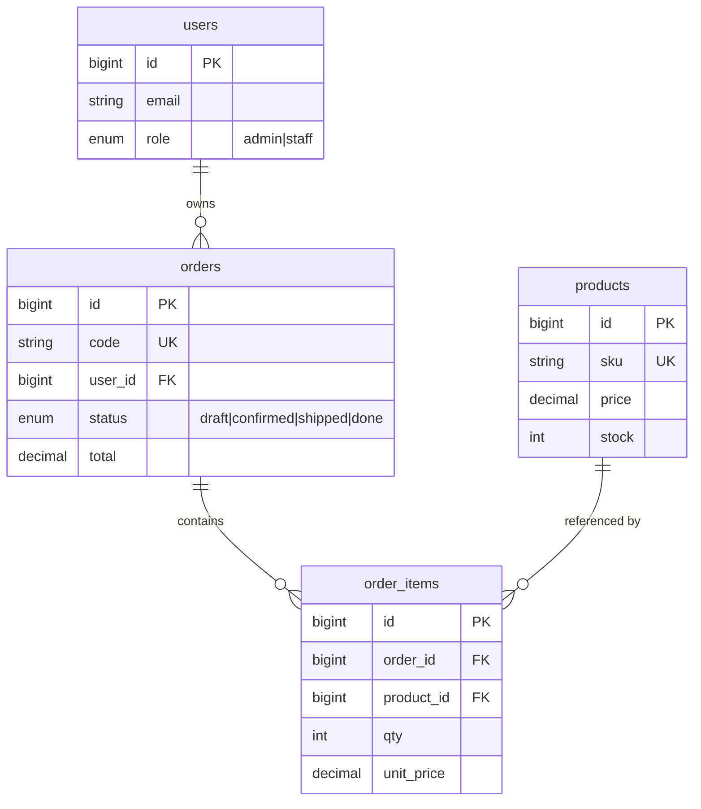

# Orderdesk

A small order desk for a distributor. Staff enter orders, an admin reviews them and moves
each one through `draft`, `confirmed`, `shipped`, `done`. Four screens: order list with
search, new order form, order detail with status transitions, sign in.

Laravel 13, MySQL 8, Tailwind 4, Alpine 3.

## Why the history looks like this

The first working version is tagged `v1-insecure`. It does everything above and gets four
things wrong on purpose. The commits after it are the fixes, each preceded by a test that
fails on `v1-insecure`. To see the version with the bugs:

```bash
git checkout v1-insecure
```

This is not a red-team exercise and nothing here touched a system that was not mine.

## Running it

```bash
composer install
cp .env.example .env
php artisan key:generate

# create the database first, then set DB_* in .env
php artisan migrate --seed
npm install && npm run build
php artisan serve
```

Seeded accounts, all with password `password`:

| Email | Role |
|---|---|
| `admin@orderdesk.test` | admin |
| `staff1@orderdesk.test` | staff |
| `staff2@orderdesk.test` | staff |

Twenty orders and eight products are seeded. The seeder does not decrement stock; it writes
demo data directly.

## Data model



Three choices in that diagram are deliberate:

**`order_items.unit_price` is a snapshot.** Reading the price from `products` at render time
would mean an order's total changes whenever an admin edits the catalogue. The order would
stop being a record of what happened.

**`order_items.product_id` is `RESTRICT`, not `CASCADE`.** Deleting a product must not erase
order history. `order_id` is `CASCADE`, because an order that no longer exists has no lines.

**`products.stock` is signed, not `UNSIGNED`.** An unsigned column turns an oversell into a
database error and hides it behind a 500. The guard belongs in the application, where it can
refuse the operation and say why. See `C-01` below.

## What v1 got wrong

### F-01 Broken object level authorization

`OrderController@show` took the route model binding and handed the order to the view. Any
signed-in user could read any order by changing the id in the URL. The list was broken the
same way: it showed every order in the system to every user.

What v1 did:

```php
public function index(Request $request): View
{
    $orders = Order::query()->when($q !== '', fn ($query) => $query->whereRaw("code LIKE '%{$q}%'"))
        // no owner filter

public function show(Order $order): View
{
    // no authorization call
    $order->load(['items.product', 'user']);
```

What replaced it:

```php
public function index(Request $request): View
{
    $orders = Order::query()
        ->when(! $request->user()->isAdmin(), fn ($q) => $q->where('user_id', $request->user()->id))

public function show(Order $order): View
{
    $this->authorize('view', $order);
```

The rule lives in `App\Policies\OrderPolicy`, where admin is stated explicitly inside each
method instead of being waved through by a global `Gate::before`. A global bypass is the usual
Laravel shortcut and the usual place BOLA hides: every policy stops being exercised for the
admin, so the day a third role appears, nobody notices it inherits everything.

Locked by `OrderPolicyTest` and `OrderAccessTest::test_staff_cannot_open_another_users_order`.

### F-02 SQL injection in the order search

The search term was interpolated straight into `whereRaw`:

```php
$query->whereRaw("code LIKE '%{$q}%'");
```

`?q=' OR '1'='1` returned every order in the table. Corrected to a bound `LIKE`:

```php
$query->where('code', 'like', "%{$q}%");
```

Locked by `OrderSearchTest::test_search_term_is_not_interpreted_as_sql`, which asserts the
empty state rather than a 200, because a 200 is what the broken version returns too.

### F-03 The client set the price

The form computed a total in JavaScript and posted it back. `StoreOrderRequest` accepted
`total` and `items.*.unit_price`, both reached the model through `Fillable`, and the server
stored whatever arrived. A two-line `curl` bought two units of a 90,101 item for 1.00.

Prices are now read from the catalogue; `total` and `unit_price` were removed from the
request rules and from `Fillable` on both models, so they can only be set deliberately:

```php
foreach ($request->validated('items') as $line) {
    $product = Product::findOrFail($line['product_id']);
    $stock->reserve($product, $line['qty']);
    $order->items()->forceCreate([
        'product_id' => $product->id,
        'qty' => $line['qty'],
        'unit_price' => $product->price,
    ]);
    $total += $line['qty'] * (float) $product->price;
}
```

Locked by `OrderPricingTest`.

### C-01 Oversell, which is a correctness bug and not a vulnerability

Listed separately on purpose. It is not an attack; it is a missing guard. `StockService@reserve`
called `decrement()` with no check, so two orders for the last unit both succeeded and stock
ended at `-1`. Nothing is being exploited when that happens; the data is just wrong.

```php
DB::transaction(function () use ($product, $qty): void {
    $locked = Product::query()->whereKey($product->getKey())->lockForUpdate()->firstOrFail();

    if ($locked->stock < $qty) {
        throw InsufficientStock::forProduct($locked->sku, $qty, $locked->stock);
    }

    $locked->decrement('stock', $qty);
});
```

`lockForUpdate()` only means something inside a transaction, so `reserve()` opens one when
the caller has not. Called from the controller's transaction it nests as a savepoint.

Locked by `StockServiceTest`. See [ADR 0001](docs/adr/0001-pessimistic-lock-for-stock.md) for
why pessimistic rather than optimistic locking.

## Tests

```bash
php artisan test
```

Sixteen tests, all green on `main`:

| Seam | File | What it holds down |
|---|---|---|
| Authorization | `tests/Unit/OrderPolicyTest.php` | staff cannot read another user's order, admin can read any |
| Authorization over HTTP | `tests/Feature/OrderAccessTest.php` | the policy is actually reached by the route |
| Stock | `tests/Unit/StockServiceTest.php` | the guard throws, and stock cannot go negative |
| Status | `tests/Unit/OrderStatusTest.php` | `draft` moves only to `confirmed`, `done` is terminal |
| Pricing | `tests/Feature/OrderPricingTest.php` | the server ignores a client-supplied total |
| Search | `tests/Feature/OrderSearchTest.php` | the search term is data, not SQL |

**What the stock tests do not prove.** The oversell test runs two reservations in sequence,
not concurrently. Proving the race itself needs two processes against a real MySQL instance.
The test locks down the guard; the lock is argued in the ADR, not demonstrated by a test.
Saying otherwise would be a claim I cannot back with output.

## Limits

- No payment, no shipping integration. Out of scope for a four-screen demo.
- Login has no throttling. Laravel's `ThrottleRequests` would be the first thing to add.
- Single context. No multi-tenancy, no per-warehouse stock.
- No audit trail. Whoever changes a status, nothing records it.
- Deployment is not set up. It runs locally.

## Layout

```
app/Enums/OrderStatus.php        status values and the allowed transitions
app/Exceptions/InsufficientStock.php
app/Policies/OrderPolicy.php     view and update rules
app/Services/StockService.php    reservation with a row lock
database/migrations/             schema
docs/adr/                        one decision record
tests/                           sixteen tests, four seams
DESIGN.md                        why the interface looks the way it does
```